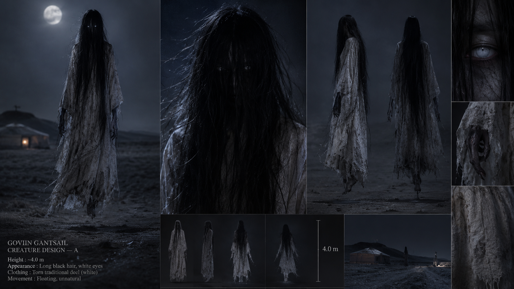
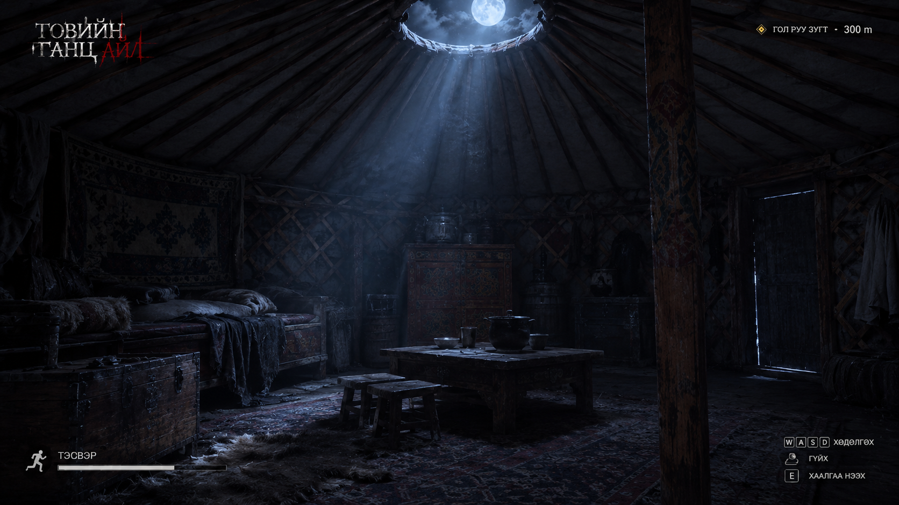
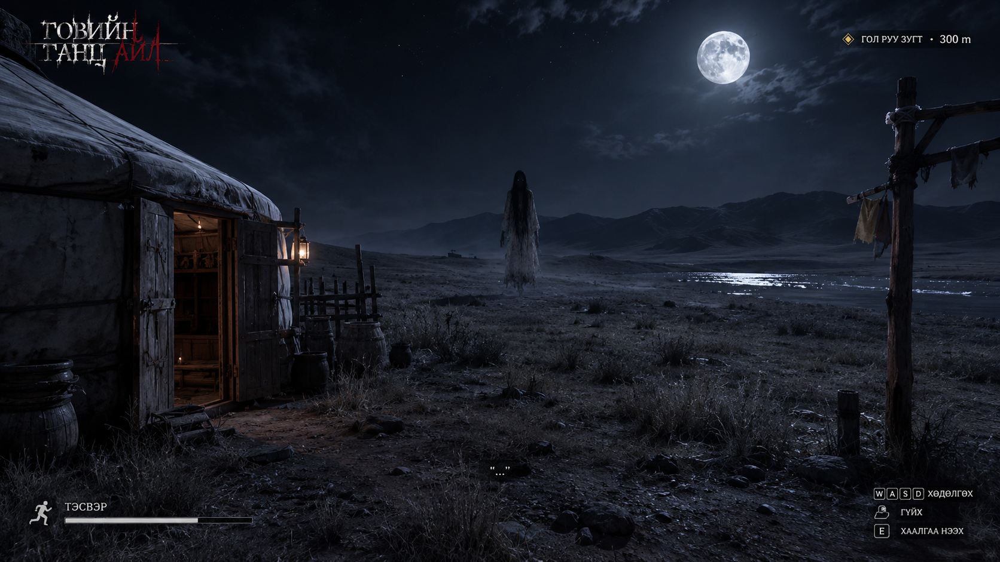

# ゴビの一軒家 — GOVIIN GANTS AIL
### モンゴルの民間伝承をモチーフにしたサバイバルホラーゲーム

[English](README.md) | [日本語](README.ja.md) | [Монгол](README.mn.md)

---

## ゲーム概要

**Goviin Gants Ail（ゴビの一軒家）** は、モンゴルの民間伝承と広大な草原の不気味な雰囲気から着想を得た、一人称視点のサバイバルホラーゲームです。

真夜中、誰もいない古びたゲルの中で目を覚ましたあなた。暗闇の中を進み、追いかけてくる恐ろしい存在から逃げなければなりません。

探索し、体力を管理し、川を渡って生き延びましょう。

## ストーリー

あなたは古びたモンゴルのゲルの中で、一人目を覚まします。

何かがおかしい。周囲は静まり返り、草原には誰もいません。そして、外には何かが潜んでいます。

目的はただ一つ。ここから逃げること。

しかし、あなたは決して一人ではありません。

## スクリーンショット







## ゲームの遊び方

- 古びたゲルの中で目を覚ます。
- 外へ出る方法を見つける。
- 追いかけてくる存在から逃げる。
- 走る際はスタミナを管理する。
- 川を渡り、生き延びる。

## 操作方法

| キー | 操作 |
|---|---|
| W / A / S / D | 移動 |
| マウス | 視点操作 |
| Shift | 走る |

## インストールと起動方法

Node.js と npm がインストールされていることを確認してください。

```bash
# リポジトリをクローン
git clone YOUR_REPOSITORY_URL

# プロジェクトフォルダへ移動
cd gantsail

# 依存関係をインストール
npm install

# 開発サーバーを起動
npm run dev
```

ターミナルに表示されたローカルURLをブラウザで開くとプレイできます。

## 使用技術

- TypeScript
- Web Audio API
- 3Dゲームレンダリング
- Vite 開発環境

---

**GOVIIN GANTS AIL**  
*モンゴルの草原に広がる闇への旅。*
