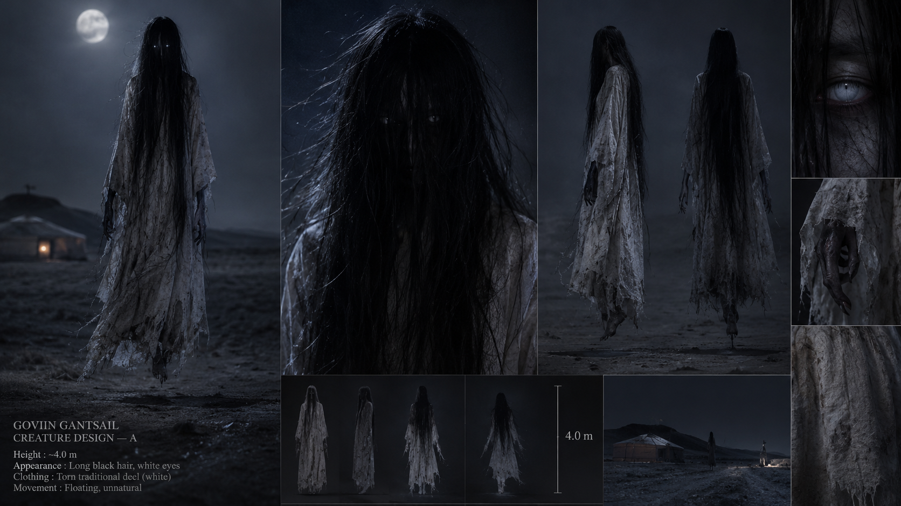
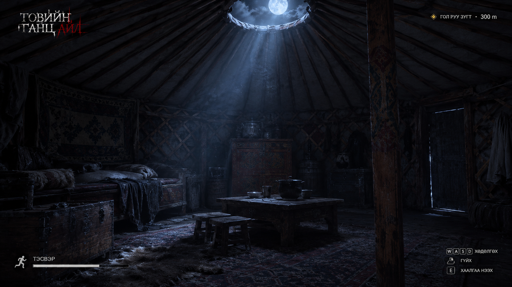
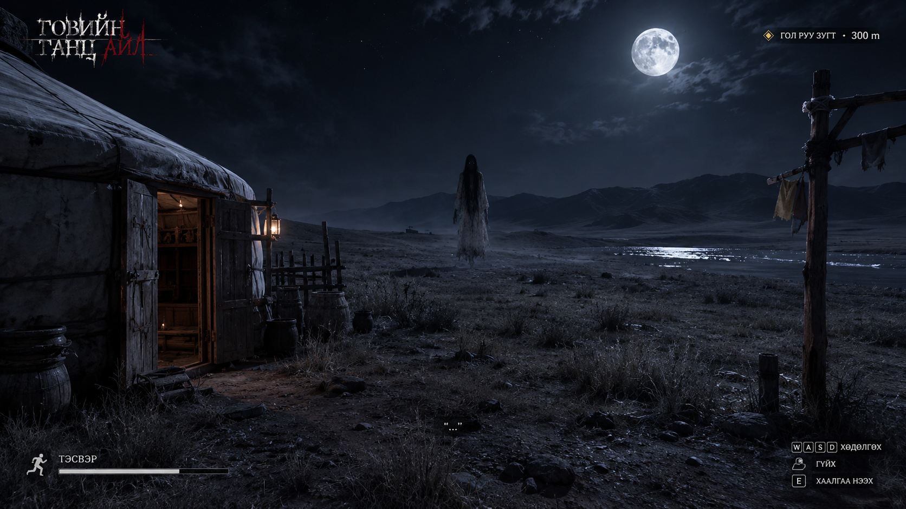

# GOVIIN GANTS AIL
### A Mongolian Folk Horror Survival Game

[English](README.md) | [日本語](README.ja.md) | [Монгол](README.mn.md)

---

## Game Overview

**Goviin Gants Ail** is a first-person survival horror game inspired by Mongolian folklore and the mysterious atmosphere of the Mongolian steppe.

Stranded in an abandoned ger in the middle of the night, you must find your way through the dark and escape from a terrifying presence chasing you.

Explore, survive, manage your stamina, and make it across the river before it catches you.

## Story

You wake up alone inside an old Mongolian ger.

Something feels wrong. The surroundings are silent, the steppe is empty, and something is waiting outside.

Your only goal is to escape.

But you are not alone out there.

## Screenshots







## How to Play

- Wake up inside the abandoned ger.
- Find your way outside.
- Escape the entity pursuing you.
- Manage your stamina carefully while running.
- Reach and cross the river to survive.

## Controls

| Key | Action |
|---|---|
| W / A / S / D | Move |
| Mouse | Look around |
| Shift | Run |

## Installation & Run

Make sure you have Node.js and npm installed.

```bash
# Clone the repository
git clone YOUR_REPOSITORY_URL

# Enter the project folder
cd gantsail

# Install dependencies
npm install

# Start the development server
npm run dev
```

Open the local URL displayed in your terminal to play.

## Tech Stack

- TypeScript
- Web Audio API
- 3D game rendering
- Vite development environment

---

**GOVIIN GANTS AIL**  
*A journey into the darkness of the Mongolian steppe.*
