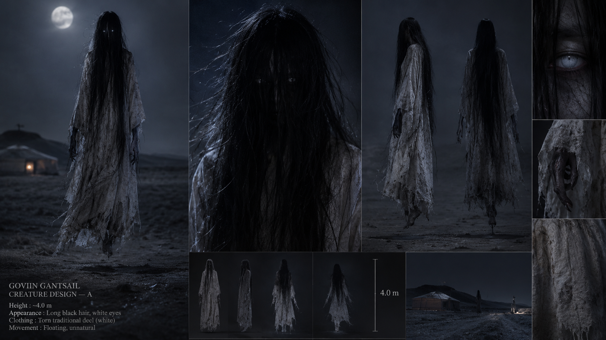
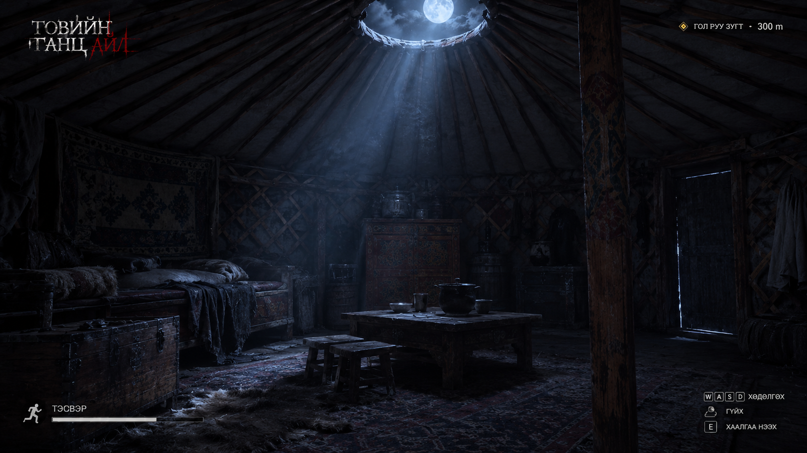
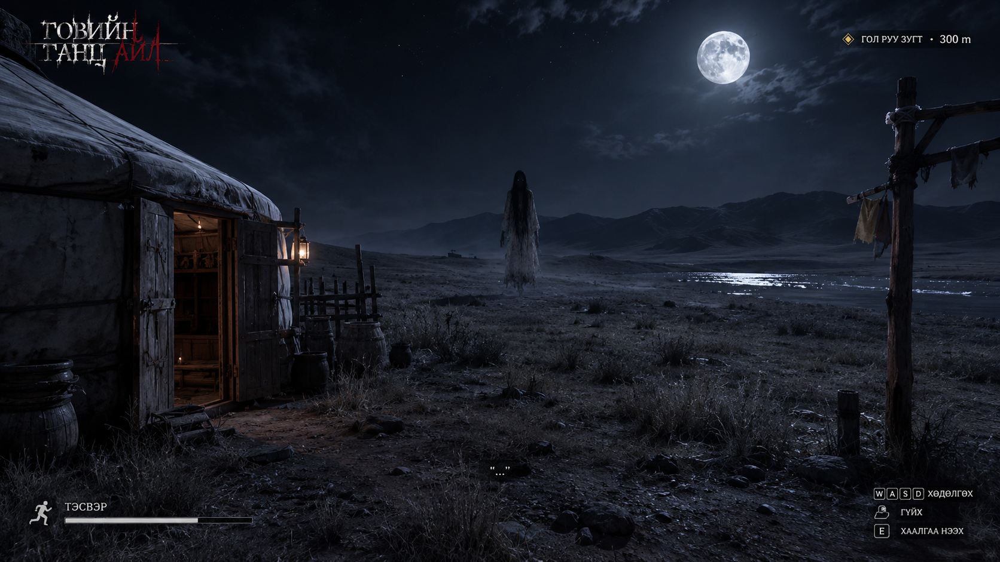

# ГОВИЙН ГАНЦ АЙЛ
### Монголын ардын домог, аймшгийн уур амьсгалаас сэдэвлэсэн survival horror тоглоом

[English](README.md) | [日本語](README.ja.md) | [Монгол](README.mn.md)

---

## Тоглоомын тухай

**Говийн ганц айл** бол Монголын ардын домог, уудам тал нутгийн нууцлаг, айдас төрүүлэм уур амьсгалаас сэдэвлэсэн нэгдүгээр биеийн өнцгөөс тоглох survival horror тоглоом юм.

Шөнө дунд эзгүй хуучин гэрт ганцаараа сэрсэн чи харанхуй тал нутгаар замаа олж, араас чинь хөөж буй аймшигт зүйлээс зугтах хэрэгтэй.

Орчноо судалж, тамираа зөв зохицуулж, голыг гатлан амьд үлд.

## Үйл явдал

Чи шөнө дунд хуучин Монгол гэрийн дотор ганцаараа сэрнэ.

Ямар нэг зүйл буруу байна. Эргэн тойрон нам гүм, тал нутаг эзгүй, харин гадаа ямар нэг зүйл чамайг хүлээж байна.

Чиний ганц зорилго бол зугтах.

Гэхдээ чи тэнд ганцаараа биш.

## Тоглоомын зургууд







## Хэрхэн тоглох вэ?

- Эзгүй хуучин гэрийн дотор сэрнэ.
- Гэрээс гарах замаа ол.
- Чамайг хөөж буй зүйлээс зугт.
- Гүйх үедээ тамираа зөв зохицуул.
- Голыг гаталж амьд үлд.

## Удирдлага

| Товчлуур | Үйлдэл |
|---|---|
| W / A / S / D | Хөдөлгөөн |
| Mouse | Эргэн тойрноо харах |
| Shift | Гүйх |

## Суулгах болон ажиллуулах

Эхлээд Node.js болон npm суулгасан байх шаардлагатай.

```bash
# Repository-г татаж авах
git clone YOUR_REPOSITORY_URL

# Төслийн хавтас руу орох
cd gantsail

# Шаардлагатай сангуудыг суулгах
npm install

# Хөгжүүлэлтийн сервер ажиллуулах
npm run dev
```

Terminal дээр гарч ирэх local URL-ийг browser дээр нээж тоглоно.

## Ашигласан технологи

- TypeScript
- Web Audio API
- 3D game rendering
- Vite development environment

---

**ГОВИЙН ГАНЦ АЙЛ**  
*Монголын тал нутгийн харанхуй руу хийх аялал.*
